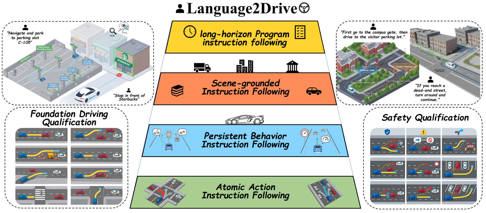
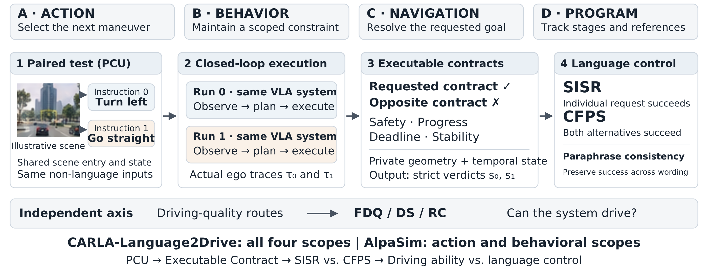
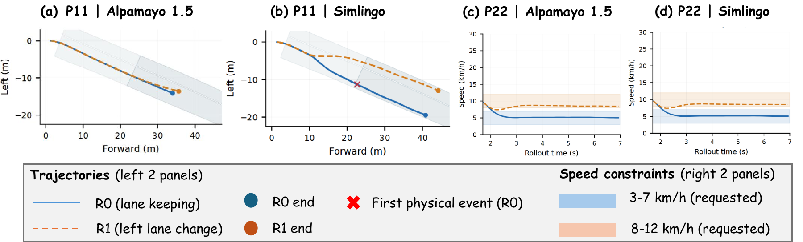
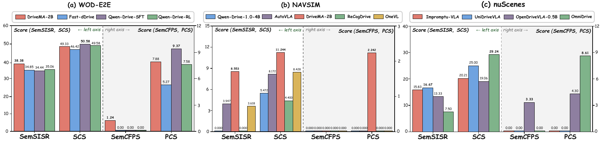

<div align="center">

# Language2Drive

### Do Vision-Language-Action Models Really Follow the Instructions in Autonomous Driving?

**Same scene. Same seed. Different instructions.**<br>
A paired counterfactual benchmark that separates driving quality from language control.

[](docs/assets/language2drive-paper.pdf)
[](https://ZihanYou.github.io/Language2Drive/)
[](https://github.com/ZihanYou/Language2Drive)
[](#dataset--evaluation-format)
[](#benchmark-tracks)
[](#main-results--leaderboard)



**5 evaluation tracks · 4 instruction scopes · 2 matched alternatives per PCU**

[Get started](#quick-start) · [Adapt your model](docs/ADAPTER.md) · [Evaluation protocol](docs/PROTOCOL.md) · [Reproduce results](#reproduce-evaluation)

</div>

## TL;DR

- **Does language control the behavior?** A Paired Counterfactual Unit (PCU) holds the scene and seed fixed and changes only a mutually exclusive, feasible instruction.
- **Both alternatives must work.** Individual success can hide a model's preferred behavior; paired success requires successful completion of both requests.
- **Driving quality is a separate axis.** Across six principal CARLA systems, **110 of 118 successful rollouts (93.2%) are one-sided**. In RealSim, Alpamayo 1.5 achieves **100.00 Safety / 97.17 DrivingScore** but **0.00 strict paired success**.
- **Four scopes, five tracks.** Test atomic actions, persistent behaviors, grounded destinations and instruction programs across CARLA-L2D, RealSim, nuScenes, NAVSIM and WOD-E2E.
- **Adapt once.** The new SDK exposes one `predict(request)` interface, validates trajectories, exports native submissions and invokes each track's scorer. All existing track entry points remain available.

> **Release status:** source code, unified SDK and project-page source are available. The unified dataset release is **coming soon**; some necessary evaluator resources currently require granted access or licensed upstream datasets. Wheel building and PyPI publishing workflows are included; PyPI publication is pending. The linked manuscript supplies the reported results.

## Benchmark Overview

Language2Drive asks whether changing a natural-language request reliably changes **which feasible behavior a driving VLA selects and completes**. Each PCU has a shared initial driving context and two alternative instructions. Contracts verify the actual trajectory, including requested behavior, alternative rejection and the track's execution requirements.

### Scope A: Atomic Action

Choose a local maneuver: turn left, proceed straight, stop or select another feasible action.

### Scope B: Persistent Behavior

Maintain a constraint over time: speed, following distance or another scoped behavior. A momentary response does not establish completion.

### Scope C: Scene-Grounded Navigation

Resolve a destination or reference in the physical scene, rather than following a privileged target point supplied by the evaluator.

### Scope D: Long-Horizon Instruction Program

Execute an ordered program of stages while tracking references, transitions and completion conditions.

## PCU: Paired Counterfactual Unit

**Same scene / same seed / different mutually exclusive instructions.**

| Shared across the pair | Changed between the arms | Verified by the evaluator |
|---|---|---|
| Scene, initial state, non-language inputs and simulator seed | Active natural-language instruction | Actual trajectory, requested contract and rejection of the opposite contract |
| Model checkpoint and observation configuration | Requested feasible behavior | Safety, progress, deadline and stability where supported by the track |

For example, the same junction can ask **“Turn left”** or **“Go straight.”** Evaluate each from the matched initial state with independent model memory. Successful execution of one request does not imply paired success.



Strict **SISR / CFPS** distinguish individual from paired completion. **SCS / PCS** report graded compliance and paired completion. Closed-loop **SemISR / Sem-CFPS** are relaxed proxies; open-loop **SemSISR / SemCFPS** enforce exclusive semantic success. Equivalent paraphrases test wording robustness. Definitions and the nonlinear **L2D** aggregation are in [the protocol](docs/PROTOCOL.md).

The model receives public observations and the active instruction. Geometric targets, evaluator contracts and opposite-arm instructions remain outside the SDK request. This is an API boundary, not an adversarial process sandbox.

## Benchmark Tracks

| Track | Evaluation | Manuscript / frozen scope | Model output | Native guide |
|---|---|---|---|---|
| **CARLA-L2D** | Closed loop; six purpose-designed maps | **64 paper PCUs**, A–D; 384 core rollouts/system, three expressions | Ego XY → declared controller | [CARLA](language2drive.carla/README.md) |
| **RealSim** | Closed loop; AlpaSim / NuRec | **30 PCUs / 23 scenes**, A–B; 60 slots/system, seed 1701 | 6 s / 60 points, 10 Hz | [RealSim](language2drive.RealSim/README.md) |
| **nuScenes** | Open loop | **75 release PCUs**: 15 dev + 60 held-out; paper uses held-out canonical | 3 s / 12 points, 4 Hz | [nuScenes](language2drive.OpenloopTrack.nScenes/README.md) |
| **NAVSIM** | Open loop | **38 PCUs / 19 recordings**, four wordings | 4 s / 8 points, 2 Hz | [NAVSIM](language2drive.OpenloopTrack.navsim/README.md) |
| **WOD-E2E** | Open loop | **241 P0 scored PCUs**: 76 STOP/GO + 165 speed-choice | 5 s / 20 points, 4 Hz | [WOD-E2E](language2drive.OpenloopTrack.WOD-E2E/README.md) |

**Scopes are instruction categories; tracks are evaluation environments.** Counts are not interchangeable. CARLA's source inventory is broader than the 64-PCU paper cohort; record tier, split and seed. The SDK defaults to `base` and evaluates dev/test separately. CARLA PSM uses 24 additional routes and requires the native diagnostic evaluation. WOD's public workload can include construction candidates beyond the frozen 241-PCU scored subset.

## Main Results / Leaderboard

Values below are transcribed from the supplied manuscript; all scores are **0–100, higher is better**. Systems are compared **within each track and profile**. [Interactive leaderboard](https://ZihanYou.github.io/Language2Drive/#leaderboard) · [Machine-readable results](docs/data/results.json) · [Submission guide](docs/LEADERBOARD.md).

### CARLA-L2D

paper: 64 PCUs · 3 expressions · seed 1.

| System | SISR | CFPS | SemISR | Sem-CFPS | SCS | PCS | PSM | DrivingScore | L2D |
|---|---:|---:|---:|---:|---:|---:|---:|---:|---:|
| Alpamayo 1.5 | 8.07 | 1.04 | 42.19 | 30.73 | 26.18 | 12.50 | 70.10 | 62.69 | 12.20 |
| SimLingo | 7.81 | 1.04 | 48.70 | 35.94 | 23.51 | 11.94 | 62.30 | 65.04 | 12.15 |
| LMDrive | 12.24 | 0.00 | 29.17 | 18.23 | 21.45 | 9.26 | 88.84 | 50.12 | 10.39 |
| OneVL | 0.52 | 0.00 | 25.00 | 3.65 | 16.69 | 7.05 | 77.72 | 50.69 | 4.87 |
| Qwen-Drive-1.0-4B | 1.82 | 0.00 | 15.62 | 3.12 | 17.05 | 7.09 | 76.68 | 43.67 | 4.31 |
| Impromptu-VLA | 0.26 | 0.00 | 19.79 | 6.25 | 14.48 | 4.61 | 77.43 | 42.02 | 3.87 |

### RealSim

realsim-paper-1.0: 30 PCUs · seed 1701.

| System | SISR | CFPS | SemISR | Sem-CFPS | SCS | PCS | Safety | DrivingScore | L2D |
|---|---:|---:|---:|---:|---:|---:|---:|---:|---:|
| Alpamayo2-Super | 13.33 | 0.00 | 18.33 | 0.00 | 21.43 | 0.00 | 93.33 | 97.10 | 9.22 |
| Alpamayo 1.5 | 11.67 | 0.00 | 15.00 | 0.00 | 18.12 | 1.11 | 100.00 | 97.17 | 8.38 |
| SimLingo | 6.67 | 3.33 | 13.33 | 6.67 | 16.67 | 10.00 | 68.33 | 83.09 | 7.58 |
| AutoVLA | 1.67 | 0.00 | 8.33 | 6.67 | 9.73 | 6.67 | 41.67 | 76.94 | 3.36 |
| Qwen-Drive-1.0-4B | 0.00 | 0.00 | 1.67 | 0.00 | 4.44 | 0.00 | 43.33 | 69.16 | 0.92 |
| Impromptu-VLA | 0.00 | 0.00 | 1.67 | 0.00 | 3.71 | 0.00 | 30.00 | 68.85 | 0.78 |
| OneVL | 0.00 | 0.00 | 0.00 | 0.00 | 0.00 | 0.00 | 43.33 | 43.82 | 0.44 |
| ReCogDrive | 0.00 | 0.00 | 0.00 | 0.00 | 0.00 | 0.00 | 33.33 | 43.57 | 0.38 |

### nuScenes

v1.0-test · 60 held-out PCUs · canonical.

| System | SemSISR | SemCFPS | SCS | PCS |
|---|---:|---:|---:|---:|
| Impromptu-VLA | 15.83 | 0.00 | 20.21 | 0.00 |
| UniDriveVLA | 16.67 | 0.00 | 25.00 | 0.00 |
| OpenDriveVLA-0.5B | 13.33 | 3.33 | 19.06 | 4.30 |
| OmniDrive | 7.50 | 0.00 | 29.24 | 8.61 |

### NAVSIM

paper historical scorer · 38 PCUs · 4 wordings.

| System | SemSISR | SemCFPS | SCS | PCS |
|---|---:|---:|---:|---:|
| Qwen-Drive-1.0-4B | 0.000 | 0.000 | 5.472 | 0.000 |
| AutoVLA | 3.947 | 0.000 | 8.172 | 0.000 |
| DriveMA-2B | 8.553 | 0.000 | 11.244 | 2.242 |
| ReCogDrive | 0.000 | 0.000 | 4.400 | 0.000 |
| OneVL | 3.618 | 0.000 | 8.428 | 0.000 |

### WOD-E2E

P0 · 241 PCUs · canonical.

| System | SemSISR | SemCFPS | SCS | PCS |
|---|---:|---:|---:|---:|
| DriveMA-2B | 38.38 | 1.24 | 49.33 | 7.88 |
| Fast-dDrive | 34.85 | 0.00 | 46.42 | 5.27 |
| Qwen-Drive-SFT | 34.44 | 0.00 | 50.58 | 9.37 |
| Qwen-Drive-RL | 35.06 | 0.00 | 49.58 | 7.58 |

The CARLA table includes the six principal systems; the paper's Senna high-level bridge is a separate diagnostic configuration. **NAVSIM numbers use the historical manuscript scorer.** New SDK runs use `score_corrected.py`; keep corrected evaluations in a separate leaderboard profile. Full protocol, coverage and failure denominators must accompany submissions. There is no pooled cross-track rank.

## Visualization / Example Cases

<details open>
<summary><b>Closed-loop counterfactual execution</b></summary>



</details>

<details>
<summary><b>Open-loop benchmark results</b></summary>



</details>

The figures are taken from the supplied manuscript. The project's interactive junction is explicitly a conceptual illustration, not an experimental rollout.

## Installation

The SDK coordinator supports **Python 3.10+**. Model dependencies stay in your model's own environment. CARLA's evaluator uses **Python 3.11**; the pinned AlpaSim runtime uses **Python 3.12**. Linux / compatible NVIDIA runtime is required for live simulator evaluation.

```sh
git clone https://github.com/ZihanYou/Language2Drive.git
cd Language2Drive
python -m pip install -e '.[openloop]'

# Select only the environments you need; no checkpoint download by default
language2drive setup --tracks nuscenes,navsim,wod

# Inspect a complete installation / resource plan before running it
language2drive setup --tracks all --runtime --download --dry-run

# Provision simulator dependencies and download accessible resources
language2drive setup --tracks all --runtime --download
```

`setup` probes Hugging Face and PyPI independently: reachable official endpoints are preferred; otherwise it selects the HF mirror and Tsinghua PyPI index. Override with `--network official` or `--network mirror`. Authenticated benchmark downloads require the official HF endpoint; credentials are never forwarded to mirrors by this SDK. Waymo assets require `--source-root /path/to/licensed/waymo`. nuScenes source images and frozen evaluator sidecars must be supplied where required. See [installation and resource access](docs/INSTALLATION.md).

**Wheel installation:** build or download the release wheel; it includes checksum-verified backend source and notices, not model weights, simulator binaries or raw datasets.

```sh
python -m pip install build
python scripts/build_release.py
python -m pip install dist/language2drive-0.1.0-py3-none-any.whl
language2drive init --workspace ./l2d-workspace
language2drive setup --workspace ./l2d-workspace --tracks navsim \
  --package dist/language2drive-0.1.0-py3-none-any.whl
```

After maintainers publish the included PyPI workflow, the equivalent index installation will be:

```sh
pip install language2drive                 # coordinator + packaged backend sources
pip install 'language2drive[openloop]'     # optional offline evaluator dependencies
pip install 'language2drive[carla]'        # optional CARLA evaluator dependencies
pip install 'language2drive[realsim]'      # optional RealSim evaluator dependencies
```

Extras install Python dependencies. `setup --runtime` provisions separate simulator environments; host GPU drivers, external runtime services and gated dataset permissions remain deployment prerequisites. [Release instructions](docs/RELEASE.md) explain GitHub Pages and PyPI activation.

## Quick Start

### 1. Check the interface without datasets

```sh
language2drive adapter-check --adapter examples/constant_velocity.py
```

This synthetic constant-speed example verifies all five trajectory contracts. It is **not a benchmark result**.

### 2. Adapt your model once

Implement the factory and `predict(request)` in [examples/my_model.py](examples/my_model.py), using [the adapter guide](docs/ADAPTER.md). A prediction returns XY waypoints with explicit frame, reference point and timestamps. Convert your model's frame and horizon inside the adapter.

```python
from l2d_benchmark import Request

class Adapter:
    def predict(self, request: Request):
        xy = my_model(request.observation, request.instruction)
        return {
            "coordinate_frame": request.output_spec.coordinate_frame,
            "reference_point": request.output_spec.reference_point,
            "timestamps_s": list(request.output_spec.timestamps_s),
            "xy_m": xy,
        }

def create_adapter(config):
    return Adapter()
```

### 3. Start your model service and evaluate

```sh
# Terminal 1: your existing model environment
language2drive serve --adapter examples/my_model.py --config model.json

# Terminal 2: edit data paths and runtime endpoints in examples/evaluation.json
language2drive evaluate --config examples/evaluation.json \
  --tracks all --output outputs/my-model

# Any subset uses the same adapter
language2drive evaluate --config examples/evaluation.json \
  --tracks nuscenes,navsim,wod --output outputs/my-model
```

The example configuration contains explicit `PATH/TO/...` placeholders. Resolve them first. Workspace is relative to the configuration file; track paths are relative to the workspace. Full closed-loop evaluation requires running CARLA / AlpaSim services; [the installation guide](docs/INSTALLATION.md) describes the unified RealSim driver configuration.

Each track saves native predictions, score files, coverage and logs. `summary.json` links each track's artifacts; a failed track makes the command return nonzero while other selected tracks continue. Open-loop inference resumes from a configuration- and service-bound ledger. Failed requests remain in the scheduled inventory; rerun a new output directory when intentionally changing model or configuration.

## Dataset / Evaluation Format

**Unified dataset release: coming soon.** Public workload definitions and native evaluator code are in the track directories. Frozen private contracts and some replay bundles are separate resources; upstream datasets retain their own access terms.

| Layer | Contents | Consumer |
|---|---|---|
| Public observation | Cameras, observed ego state/history, active instruction | Model adapter |
| Trajectory request | Track, ego frame, reference point, timestamp grid, model seed | Model adapter |
| Evaluator metadata | PCU and arm identities, contracts, pair binding and expected inventory | Track runner / scorer |
| Submission | Native trajectory format per track | Native scorer |
| Result | Scores, scheduled coverage, failures, provenance and protocol | Leaderboard / analysis |

```json
{
  "coordinate_frame": "ego_at_anchor",
  "reference_point": "rear_axle",
  "timestamps_s": [0.5, 1.0, 1.5, 2.0, 2.5, 3.0, 3.5, 4.0],
  "xy_m": [[1, 0], [2, 0], [3, 0], [4, 0], [5, 0], [6, 0], [7, 0], [8, 0]]
}
```

This is the **NAVSIM** output grid. nuScenes uses `ego_pose_origin`; RealSim uses `rig_origin`. All SDK XY outputs use **+x forward, +y left, metres**. Wrong reference points, nonfinite coordinates and incompatible time grids are rejected. Full [adapter schema](docs/ADAPTER.md) and [protocol / native export formats](docs/PROTOCOL.md) are documented separately.

## Reproduce Evaluation

Preserve the original model integrations, frozen release and scorer version when reproducing manuscript baselines. A custom adapter plus the new CARLA controller is a new evaluated system configuration, not an automatic reproduction of a paper baseline.

| Track | Reproduction entry point | Required evidence / profile |
|---|---|---|
| CARLA | [Native guide](language2drive.carla/README.md), `l2d run`, `l2d score` | Base cohort, dev + test, seed 1, three expressions; native checkpoint/controller; PSM diagnostics separately |
| RealSim | [Native guide](language2drive.RealSim/README.md), `l2d-realsim`, `l2d-score` | Frozen 30-PCU source, 60 seed-1701 slots, real ASL receipts and pinned runtime |
| nuScenes | `python scripts/reproduce_paper.py --check-paper` from [track directory](language2drive.OpenloopTrack.nScenes) | Frozen `v1.0-test` held-out release and verified replay bundle |
| NAVSIM | `sh scripts/run_paper_legacy_scoring.sh` from [track directory](language2drive.OpenloopTrack.navsim) | Historical scorer environment; `--sidecars`, `--predictions`, `--rewrite-predictions`, `--output` |
| WOD-E2E | `python scripts/evaluate_paper.py` from [track directory](language2drive.OpenloopTrack.WOD-E2E) | Frozen P0 contracts, licensed release inputs and native predictions |

```sh
python -m unittest discover -s tests -v
python scripts/check_site.py
python scripts/build_release.py
python scripts/check_wheel.py dist/language2drive-0.1.0-py3-none-any.whl
```

These checks validate SDK behavior, page assets and a clean wheel installation. They do not execute the GPU simulator experiments. [Protocol](docs/PROTOCOL.md) · [Release guide](docs/RELEASE.md) · [Contributing](CONTRIBUTING.md).

## Citation

Provisional citation for the supplied manuscript. Final author names and archival metadata will be added at paper release.

```bibtex
@misc{language2drive,
  title = {Language2Drive: Do Vision-Language-Action Models Really Follow the Instructions in Autonomous Driving?},
  note  = {Research manuscript},
  url   = {https://github.com/ZihanYou/Language2Drive}
}
```

## License

Original Language2Drive code is under the [MIT License](LICENSE). Third-party code, simulators, datasets and checkpoints retain their original licenses and notices; the SDK wheel preserves backend notices. See [CARLA third-party notices](language2drive.carla/THIRD_PARTY_NOTICES), [RealSim notices](language2drive.RealSim/NOTICE.md) and each upstream dataset's terms. The manuscript and its figures are research materials, separate from the code license.
