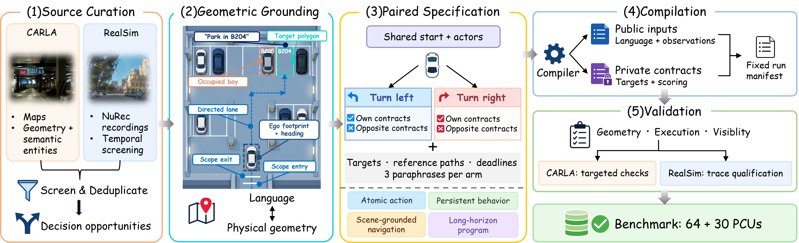

<div align="center">

# 🚘 Language2Drive

### Do Vision-Language-Action Models Really Follow the Instructions in Autonomous Driving?

**👥 Authors**

Zihan You<sup>1,2,*,†</sup>, Zehua Fan<sup>3,*</sup>, Wenqi Lyu<sup>4,*</sup>, Aoqi Wang<sup>5,*</sup>,<br>
Ni Wang<sup>6</sup>, Yifei Yang<sup>7</sup>, Linge Zhao<sup>8</sup>, Huan Li<sup>9</sup>, Sining Ang<sup>10</sup>, Yuguang Yang<sup>1</sup>,<br>
Jueyu Chen<sup>10,11</sup>, Xiangyu Li<sup>12</sup>, Qianshan Wei<sup>13</sup>, Jieyuan Pei<sup>1,14,15</sup>, Yuxin Wang<sup>16</sup>, Zhiwen Chen<sup>15</sup>,<br>
Jiaqi Li<sup>17</sup>, Wenxuan Song<sup>15</sup>, Yanyuan Qiao<sup>18</sup>, Benjin Zhu<sup>19</sup>, Haoang Li<sup>15</sup>, Yan Wang<sup>1,‡</sup>

**🏛️ Affiliations**

<sup>1</sup> THU · <sup>2</sup> SEU · <sup>3</sup> SJTU · <sup>4</sup> Adelaide · <sup>5</sup> BISTU · <sup>6</sup> Amazon · <sup>7</sup> BJTU<br>
<sup>8</sup> WHU · <sup>9</sup> HUST · <sup>10</sup> USTC · <sup>11</sup> NIO · <sup>12</sup> UT Austin · <sup>13</sup> CAS<br>
<sup>14</sup> HiThink · <sup>15</sup> HKUST(GZ) · <sup>16</sup> AMD · <sup>17</sup> HKU · <sup>18</sup> EPFL · <sup>19</sup> Li Auto

<sub>* Core contributors &nbsp; † Project Lead &nbsp; ‡ Corresponding author</sub>

**Same scene. Same seed. Different instructions.**<br>
Measure whether language changes what a driving VLA actually does.

[](#citation)
[](#project-page-preview)
[](https://github.com/ZihanYou/Language2Drive)
[](https://huggingface.co/datasets/Mike087/Language2Drive/tree/main)
[](#benchmark-tracks)
[](#main-results--leaderboard)


**4 instruction scopes &nbsp; · &nbsp; 3 runtime groups &nbsp; · &nbsp; 5 evaluation backends**

[⚡ Quick Start](#quick-start) &nbsp; / &nbsp; [🔌 Model Adapter](docs/ADAPTER.md) &nbsp; / &nbsp; [📐 Protocol](docs/PROTOCOL.md) &nbsp; / &nbsp; [📊 Results](#main-results--leaderboard)

</div>


<a id="benchmark-overview"></a>

## 🧭 Benchmark Overview

Recent Vision-Language-Action (VLA) models increasingly use natural-language instructions to condition autonomous driving behavior. Yet existing closed-loop benchmarks primarily measure route completion, safety, and rule compliance, leaving a fundamental question unresolved: does language actually determine which feasible behavior the vehicle executes? A trajectory may be safe and successful while still violating or even ignoring the passenger's instruction. To address this, we introduce Language2Drive, a benchmark designed to directly test this capability. Its key evaluation unit, the paired counterfactual unit (PCU), holds the initial driving scene fixed while changing only the instruction. This design enables us to distinguish isolated instruction success from counterfactual paired success across four instruction-following scopes. To test whether this distinction persists across evaluation regimes, we instantiate Language2Drive in complementary closed-loop CARLA simulation, reconstructed real-world scenes, and open-loop driving benchmarks, including our released CARLA-Language2Drive simulator with purpose-built maps. Evaluating representative driving VLAs across these settings reveals a striking mismatch between strong driving competence and weak language control: 93.2% of successful rollouts do not have a successful counterpart under the alternative feasible instruction. This failure is dominated by one-sided completion, where a model repeatedly executes one preferred behavior but fails when the same scene requires the counterfactual alternative. These results expose two fundamental limitations of current evaluation: **isolated success and driving scores, which are widely used by conventional driving benchmarks, can substantially overstate language-following capability, while current driving VLAs themselves lack reliable instruction following under matched counterfactual tests**. Effective evaluation must therefore measure not only whether a VLA can drive successfully, but whether changing the instruction reliably alters which feasible behavior it selects and successfully executes.


## 🔀 PCU: Paired Counterfactual Unit

**Same scene / same seed / different mutually exclusive instructions.**

| Shared across the pair | Changed between the arms | Verified by the evaluator |
|---|---|---|
| Scene, initial state, non-language inputs and simulator seed | Active natural-language instruction | Actual trajectory, requested contract and rejection of the opposite contract |
| Model checkpoint and observation configuration | Requested feasible behavior | Safety, progress, deadline and stability where supported by the track |

For example, the same junction can ask **“Turn left”** or **“Go straight.”** Evaluate each from the matched initial state with independent model memory. Paired success requires completing both requests.

<a id="benchmark-construction"></a>

### 🏗️ Benchmark construction



Source scenes are grounded geometrically, paired with feasible instructions, compiled into executable contracts and validated before evaluation. Three paraphrases per arm test wording sensitivity.

Strict **SISR / CFPS** distinguish individual from paired completion. **SCS / PCS** report graded compliance and paired completion. Closed-loop **SemISR / Sem-CFPS** are relaxed proxies; open-loop **SemSISR / SemCFPS** enforce exclusive semantic success. Equivalent paraphrases test wording robustness. Definitions and the nonlinear **L2D** aggregation are in [the protocol](docs/PROTOCOL.md).

The model receives public observations and the active instruction. Geometric targets, evaluator contracts and opposite-arm instructions remain outside the SDK request.

<a id="benchmark-tracks"></a>

## 🛣️ Benchmark Tracks

| Track | Evaluation | Manuscript / frozen scope | Model output | Native guide |
|---|---|---|---|---|
| **CARLA-L2D** | Closed loop; six purpose-designed maps | **64 paper PCUs**, A–D; 384 core rollouts/system, three expressions | Ego XY → declared controller | [CARLA](language2drive.carla/README.md) |
| **RealSim** | Closed loop; AlpaSim / NuRec | **30 PCUs / 23 scenes**, A–B; 60 slots/system, seed 1701 | 6 s / 60 points, 10 Hz | [RealSim](language2drive.RealSim/README.md) |
| **nuScenes** | Open loop | **75 release PCUs**: 15 dev + 60 held-out; paper uses held-out canonical | 3 s / 12 points, 4 Hz | [nuScenes](language2drive.OpenloopTrack.nScenes/README.md) |
| **NAVSIM** | Open loop | **38 PCUs / 19 recordings**, four wordings | 4 s / 8 points, 2 Hz | [NAVSIM](language2drive.OpenloopTrack.navsim/README.md) |
| **WOD-E2E** | Open loop | **241 P0 scored PCUs**: 76 STOP/GO + 165 speed-choice | 5 s / 20 points, 4 Hz | [WOD-E2E](language2drive.OpenloopTrack.WOD-E2E/README.md) |

**Scopes are instruction categories; tracks are evaluation environments.** Counts are not interchangeable. CARLA's source inventory is broader than the 64-PCU paper cohort; record tier, split and seed. The SDK defaults to `base` and evaluates dev/test separately. CARLA PSM uses 24 additional routes and requires the native diagnostic evaluation. WOD's public workload can include construction candidates beyond the frozen 241-PCU scored subset.

<a id="main-results--leaderboard"></a>

## 🏆 Main Results / Leaderboard

**All reported systems use the training-free protocol.** Values below are transcribed from the supplied manuscript; all scores are **0–100, higher is better**. Systems are compared **within each track and profile**. [Project-page leaderboard source](docs/index.html) · [Machine-readable results](docs/data/results.json) · [Submission guide](docs/LEADERBOARD.md).

Click a model name to read its paper. Explore the [interactive metric guide](https://ZihanYou.github.io/Language2Drive/#metric-explorer) for paired success, graded compliance and the L2D score.

<details open>
<summary><b>📊 CARLA-L2D</b></summary>

paper: 64 PCUs · 3 expressions · seed 1.

| System | SISR | CFPS | SemISR | Sem-CFPS | SCS | PCS | PSM | DrivingScore | L2D |
|---|---:|---:|---:|---:|---:|---:|---:|---:|---:|
| [Alpamayo 1.5](https://arxiv.org/abs/2511.00088 "Alpamayo family paper") · [model card](https://huggingface.co/nvidia/Alpamayo-1.5-10B) | 8.07 | 1.04 | 42.19 | 30.73 | 26.18 | 12.50 | 70.10 | 62.69 | 12.20 |
| [SimLingo](https://arxiv.org/abs/2503.09594) | 7.81 | 1.04 | 48.70 | 35.94 | 23.51 | 11.94 | 62.30 | 65.04 | 12.15 |
| [LMDrive](https://arxiv.org/abs/2312.07488) | 12.24 | 0.00 | 29.17 | 18.23 | 21.45 | 9.26 | 88.84 | 50.12 | 10.39 |
| [OneVL](https://arxiv.org/abs/2604.18486) | 0.52 | 0.00 | 25.00 | 3.65 | 16.69 | 7.05 | 77.72 | 50.69 | 4.87 |
| [Qwen-Drive-1.0-4B](https://arxiv.org/abs/2609.00111) | 1.82 | 0.00 | 15.62 | 3.12 | 17.05 | 7.09 | 76.68 | 43.67 | 4.31 |
| [Impromptu-VLA](https://arxiv.org/abs/2505.23757) | 0.26 | 0.00 | 19.79 | 6.25 | 14.48 | 4.61 | 77.43 | 42.02 | 3.87 |

</details>

<details>
<summary><b>📊 RealSim</b></summary>

realsim-paper-1.0: 30 PCUs · seed 1701.

| System | SISR | CFPS | SemISR | Sem-CFPS | SCS | PCS | Safety | DrivingScore | L2D |
|---|---:|---:|---:|---:|---:|---:|---:|---:|---:|
| [Alpamayo2-Super](https://arxiv.org/abs/2511.00088 "Alpamayo family paper") · [model card](https://huggingface.co/nvidia/Alpamayo2-Super) | 13.33 | 0.00 | 18.33 | 0.00 | 21.43 | 0.00 | 93.33 | 97.10 | 9.22 |
| [Alpamayo 1.5](https://arxiv.org/abs/2511.00088 "Alpamayo family paper") · [model card](https://huggingface.co/nvidia/Alpamayo-1.5-10B) | 11.67 | 0.00 | 15.00 | 0.00 | 18.12 | 1.11 | 100.00 | 97.17 | 8.38 |
| [SimLingo](https://arxiv.org/abs/2503.09594) | 6.67 | 3.33 | 13.33 | 6.67 | 16.67 | 10.00 | 68.33 | 83.09 | 7.58 |
| [AutoVLA](https://arxiv.org/abs/2506.13757) | 1.67 | 0.00 | 8.33 | 6.67 | 9.73 | 6.67 | 41.67 | 76.94 | 3.36 |
| [Qwen-Drive-1.0-4B](https://arxiv.org/abs/2609.00111) | 0.00 | 0.00 | 1.67 | 0.00 | 4.44 | 0.00 | 43.33 | 69.16 | 0.92 |
| [Impromptu-VLA](https://arxiv.org/abs/2505.23757) | 0.00 | 0.00 | 1.67 | 0.00 | 3.71 | 0.00 | 30.00 | 68.85 | 0.78 |
| [OneVL](https://arxiv.org/abs/2604.18486) | 0.00 | 0.00 | 0.00 | 0.00 | 0.00 | 0.00 | 43.33 | 43.82 | 0.44 |
| [ReCogDrive](https://arxiv.org/abs/2506.08052) | 0.00 | 0.00 | 0.00 | 0.00 | 0.00 | 0.00 | 33.33 | 43.57 | 0.38 |

</details>

<details>
<summary><b>📊 nuScenes</b></summary>

v1.0-test · 60 held-out PCUs · canonical.

| System | SemSISR | SemCFPS | SCS | PCS |
|---|---:|---:|---:|---:|
| [Impromptu-VLA](https://arxiv.org/abs/2505.23757) | 15.83 | 0.00 | 20.21 | 0.00 |
| [UniDriveVLA](https://arxiv.org/abs/2604.02190) | 16.67 | 0.00 | 25.00 | 0.00 |
| [OpenDriveVLA-0.5B](https://arxiv.org/abs/2503.23463) | 13.33 | 3.33 | 19.06 | 4.30 |
| [OmniDrive](https://arxiv.org/abs/2405.01533) | 7.50 | 0.00 | 29.24 | 8.61 |

</details>

<details>
<summary><b>📊 NAVSIM</b></summary>

paper historical scorer · 38 PCUs · 4 wordings.

| System | SemSISR | SemCFPS | SCS | PCS |
|---|---:|---:|---:|---:|
| [Qwen-Drive-1.0-4B](https://arxiv.org/abs/2609.00111) | 0.000 | 0.000 | 5.472 | 0.000 |
| [AutoVLA](https://arxiv.org/abs/2506.13757) | 3.947 | 0.000 | 8.172 | 0.000 |
| [DriveMA-2B](https://arxiv.org/abs/2605.31271) | 8.553 | 0.000 | 11.244 | 2.242 |
| [ReCogDrive](https://arxiv.org/abs/2506.08052) | 0.000 | 0.000 | 4.400 | 0.000 |
| [OneVL](https://arxiv.org/abs/2604.18486) | 3.618 | 0.000 | 8.428 | 0.000 |

</details>

<details>
<summary><b>📊 WOD-E2E</b></summary>

P0 · 241 PCUs · canonical.

| System | SemSISR | SemCFPS | SCS | PCS |
|---|---:|---:|---:|---:|
| [DriveMA-2B](https://arxiv.org/abs/2605.31271) | 38.38 | 1.24 | 49.33 | 7.88 |
| [Fast-dDrive](https://arxiv.org/abs/2605.23163) | 34.85 | 0.00 | 46.42 | 5.27 |
| [Qwen-Drive-SFT](https://arxiv.org/abs/2609.00111) | 34.44 | 0.00 | 50.58 | 9.37 |
| [Qwen-Drive-RL](https://arxiv.org/abs/2609.00111) | 35.06 | 0.00 | 49.58 | 7.58 |

</details>

The CARLA table includes the six principal systems; the paper's Senna high-level bridge is a separate diagnostic configuration. **NAVSIM numbers use the historical manuscript scorer.** New SDK runs use `score_corrected.py`; keep corrected evaluations in a separate leaderboard profile. Full protocol, coverage and failure denominators must accompany submissions. Rankings follow each track’s native metrics and evaluation profile.

<a id="visualization--example-cases"></a>

## 🎬 Visualization / Example Cases

🎬 **[Watch the 2-minute project film](docs/assets/demo/language2drive-film.mp4)** · **[Explore the interactive case library](docs/index.html#examples)** · **[Prepare a model submission](docs/submit.html)**

The local project preview includes **129 clips across all five backends**, synchronized A/B CoT transcripts for Alpamayo 1.5 in CARLA and RealSim, model switching within a PCU, a NAVSIM trajectory inspector, and an animated framework built from the original author artwork. WOD-E2E includes two paired **benchmark-target** videos: **Stop / Go** and **Speed Choice**. CARLA adds **33 paired benchmark targets**, each with exterior and vehicle-front views. The **CARLA-Language2Drive map atlas** offers six interactive lane maps, 54 clickable locations with three photo views each, and 24 exploration videos with synchronized camera routes. The film is 1080p with English captions. [Preview and media build guide](docs/SHOWCASE.md).

<details open>
<summary><b>Closed-loop counterfactual execution</b></summary>


</details>

<details>
<summary><b>Open-loop benchmark results</b></summary>


</details>

Explore manuscript visualizations, the benchmark construction pipeline and an animated explanation of the paired mechanism.

<a id="installation"></a>

## 📦 Installation

The SDK coordinator supports **Python 3.10+**. Model dependencies stay in your model's own environment. CARLA's evaluator uses **Python 3.11**; the pinned AlpaSim runtime uses **Python 3.12**. Linux / compatible NVIDIA runtime is required for live simulator evaluation.

```sh
git clone https://github.com/ZihanYou/Language2Drive.git
cd Language2Drive
python -m pip install -e '.[openloop]'

# Select only the environments you need; no checkpoint download by default
language2drive setup --tracks openloop

# Inspect a complete installation / resource plan before running it
language2drive setup --tracks all --runtime --download --dry-run

# Provision simulator dependencies and download accessible resources
language2drive setup --tracks all --runtime --download
```

`setup` probes Hugging Face and PyPI independently: reachable official endpoints are preferred; otherwise it selects the HF mirror and Tsinghua PyPI index. Override with `--network official` or `--network mirror`. Authenticated benchmark downloads require the official HF endpoint; credentials are never forwarded to mirrors by this SDK. Waymo assets require `--source-root /path/to/licensed/waymo`. nuScenes source images and frozen evaluator sidecars must be supplied where required. See [installation and resource access](docs/INSTALLATION.md).

**Wheel installation:** build or download the release wheel, which packages checksum-verified backend source and notices. Use `setup` to configure simulator environments and benchmark resources.

```sh
python -m pip install build
python scripts/build_release.py
python -m pip install dist/language2drive-0.1.0-py3-none-any.whl
language2drive init --workspace ./l2d-workspace
language2drive setup --workspace ./l2d-workspace --tracks navsim \
  --package dist/language2drive-0.1.0-py3-none-any.whl
```

After maintainers publish the included PyPI workflow, the equivalent index installation will be:

```sh
pip install language2drive                 # coordinator + packaged backend sources
pip install 'language2drive[openloop]'     # optional offline evaluator dependencies
pip install 'language2drive[carla]'        # optional CARLA evaluator dependencies
pip install 'language2drive[realsim]'      # optional RealSim evaluator dependencies
```

Extras install Python dependencies. `setup --runtime` provisions separate simulator environments; host GPU drivers, external runtime services and gated dataset permissions remain deployment prerequisites. [Release instructions](docs/RELEASE.md) explain GitHub Pages and PyPI activation.

<a id="quick-start"></a>

## 🚀 Quick Start

### 1. Check the interface without datasets

```sh
language2drive adapter-check --adapter examples/constant_velocity.py
```

This synthetic constant-speed example checks adapter compatibility with all five trajectory contracts.

### 2. Adapt your model once

Implement the factory and `predict(request)` in [examples/my_model.py](examples/my_model.py), using [the adapter guide](docs/ADAPTER.md). A prediction returns XY waypoints with explicit frame, reference point and timestamps. Convert your model's frame and horizon inside the adapter.

```python
from l2d_benchmark import Request

class Adapter:
    def predict(self, request: Request):
        xy = my_model(request.observation, request.instruction)
        return {
            "coordinate_frame": request.output_spec.coordinate_frame,
            "reference_point": request.output_spec.reference_point,
            "timestamps_s": list(request.output_spec.timestamps_s),
            "xy_m": xy,
        }

def create_adapter(config):
    return Adapter()
```

### 3. Launch the three runtime groups

```sh
# Generate paths from the downloaded layout; override licensed resource paths.
language2drive configure --workspace . --gpu 0 --output .l2d/evaluation.json
language2drive gpu-check --config .l2d/evaluation.json

# Keep CUDA / model dependencies in your existing model environment.
language2drive run --config .l2d/evaluation.json \
  --adapter examples/my_model.py --model-config model.json \
  --model-python /path/to/model-env/bin/python \
  --tracks carla,realsim,openloop --output outputs/my-model
```

`openloop` expands to nuScenes, NAVSIM and WOD-E2E. Managed RealSim starts and
stops its real GPU services for every frozen execution group. CARLA retains the
native release launcher's deployment authority and frozen runtime manifest.
[Full GPU installation, resource paths and deployment guide](docs/GPU_EVALUATION.md).
`run --dry-run` prints commands without launching services. The installed wheel
is reused automatically when provisioning evaluator environments.

### 4. Use independently started services


```sh
# Terminal 1: your existing model environment
language2drive serve --adapter examples/my_model.py --config model.json

# Terminal 2: edit data paths and runtime endpoints in examples/evaluation.json
language2drive evaluate --config examples/evaluation.json \
  --tracks all --output outputs/my-model

# Any subset uses the same adapter
language2drive evaluate --config examples/evaluation.json \
  --tracks openloop --output outputs/my-model
```

The example configuration contains explicit `PATH/TO/...` placeholders. Resolve them first. Workspace is relative to the configuration file; track paths are relative to the workspace. With independently started services, full closed-loop evaluation requires running CARLA / AlpaSim services; [the installation guide](docs/INSTALLATION.md) describes the unified RealSim driver configuration.

Each track saves native predictions, score files, coverage and logs. `summary.json` links each track's artifacts; a failed track makes the command return nonzero while other selected tracks continue. Open-loop inference resumes from a configuration- and service-bound ledger. Failed requests remain in the scheduled inventory; rerun a new output directory when intentionally changing model or configuration.

<a id="dataset--evaluation-format"></a>

## 🗂️ Dataset / Evaluation Format

**Official versioned dataset release: coming soon.** [Dataset repository on Hugging Face](https://huggingface.co/datasets/Mike087/Language2Drive/tree/main). Public workload definitions and native evaluator code are in the track directories. Frozen private contracts and some replay bundles are separate resources; upstream datasets retain their own access terms.

| Layer | Contents | Consumer |
|---|---|---|
| Public observation | Cameras, observed ego state/history, active instruction | Model adapter |
| Trajectory request | Track, ego frame, reference point, timestamp grid, model seed | Model adapter |
| Evaluator metadata | PCU and arm identities, contracts, pair binding and expected inventory | Track runner / scorer |
| Submission | Native trajectory format per track | Native scorer |
| Result | Scores, scheduled coverage, failures, provenance and protocol | Leaderboard / analysis |

```json
{
  "coordinate_frame": "ego_at_anchor",
  "reference_point": "rear_axle",
  "timestamps_s": [0.5, 1.0, 1.5, 2.0, 2.5, 3.0, 3.5, 4.0],
  "xy_m": [[1, 0], [2, 0], [3, 0], [4, 0], [5, 0], [6, 0], [7, 0], [8, 0]]
}
```

This is the **NAVSIM** output grid. nuScenes uses `ego_pose_origin`; RealSim uses `rig_origin`. All SDK XY outputs use **+x forward, +y left, metres**. Wrong reference points, nonfinite coordinates and incompatible time grids are rejected. Full [adapter schema](docs/ADAPTER.md) and [protocol / native export formats](docs/PROTOCOL.md) are documented separately.

<a id="reproduce-evaluation"></a>

## 🔬 Reproduce Evaluation

Use the original model integration, controller, frozen release and scorer version to reproduce each manuscript baseline. For custom adapters, report the evaluated model and controller configuration.

| Track | Reproduction entry point | Required evidence / profile |
|---|---|---|
| CARLA | [Native guide](language2drive.carla/README.md), `l2d run`, `l2d score` | Base cohort, dev + test, seed 1, three expressions; native checkpoint/controller; PSM diagnostics separately |
| RealSim | [Native guide](language2drive.RealSim/README.md), `l2d-realsim`, `l2d-score` | Frozen 30-PCU source, 60 seed-1701 slots, real ASL receipts and pinned runtime |
| nuScenes | `python scripts/reproduce_paper.py --check-paper` from [track directory](language2drive.OpenloopTrack.nScenes) | Frozen `v1.0-test` held-out release and verified replay bundle |
| NAVSIM | `sh scripts/run_paper_legacy_scoring.sh` from [track directory](language2drive.OpenloopTrack.navsim) | Historical scorer environment; `--sidecars`, `--predictions`, `--rewrite-predictions`, `--output` |
| WOD-E2E | `python scripts/evaluate_paper.py` from [track directory](language2drive.OpenloopTrack.WOD-E2E) | Frozen P0 contracts, licensed release inputs and native predictions |

```sh
python -m unittest discover -s tests -v
python scripts/check_site.py
python scripts/build_release.py
python scripts/check_wheel.py dist/language2drive-0.1.0-py3-none-any.whl
```

These checks validate SDK behavior, page assets and a clean wheel installation. Use the native reproduction commands above for GPU simulator evaluations. [Protocol](docs/PROTOCOL.md) · [Release guide](docs/RELEASE.md) · [Contributing](CONTRIBUTING.md).
<a id="release-roadmap--todo"></a>

## 🗓️ Release Roadmap / TODO

| Status | Deliverable |
|:---:|---|
| ✅ | Benchmark source, five native evaluators and unified model-adapter SDK |
| ✅ | Wheel build, selectable environment setup and manuscript result tables |
| ✅ | evaluation resources on [Hugging Face](https://huggingface.co/datasets/Mike087/Language2Drive)|
| ✅ | Official benchmark release, supporting the use of any datasets |
| ⏳ | Official versioned dataset, model and checkpoints release|
| ⏳ | Further support |


<a id="citation"></a>

## 📚 Citation

If Language2Drive supports your research, please cite our paper.

```bibtex
@misc{language2drive,
  title = {Language2Drive: Do Vision-Language-Action Models Really Follow the Instructions in Autonomous Driving?},
  author = {You, Zihan and
           Fan, Zehua and
           Lyu, Wenqi and
           Wang, Aoqi and
           Wang, Ni and
           Yang, Yifei and
           Zhao, Linge and
           Li, Huan and
           Ang, Sining and
           Yang, Yuguang and
           Chen, Jueyu and
           Li, Xiangyu and
           Wei, Qianshan and
           Pei, Jieyuan and
           Wang, Yuxin and
           Chen, Zhiwen and
           Li, Jiaqi and
           Song, Wenxuan and
           Qiao, Yanyuan and
           Zhu, Benjin and
           Li, Haoang and
           Wang, Yan},
  howpublished = {Research manuscript},
  url = {https://github.com/ZihanYou/Language2Drive}
}
```

<a id="license"></a>

## 📄 License

Original Language2Drive code is under the [MIT License](LICENSE). Third-party code, simulators, datasets and checkpoints retain their original licenses and notices; the SDK wheel preserves backend notices. See [CARLA third-party notices](language2drive.carla/THIRD_PARTY_NOTICES), [RealSim notices](language2drive.RealSim/NOTICE.md) and each upstream dataset's terms. The manuscript and its figures are research materials, separate from the code license.
